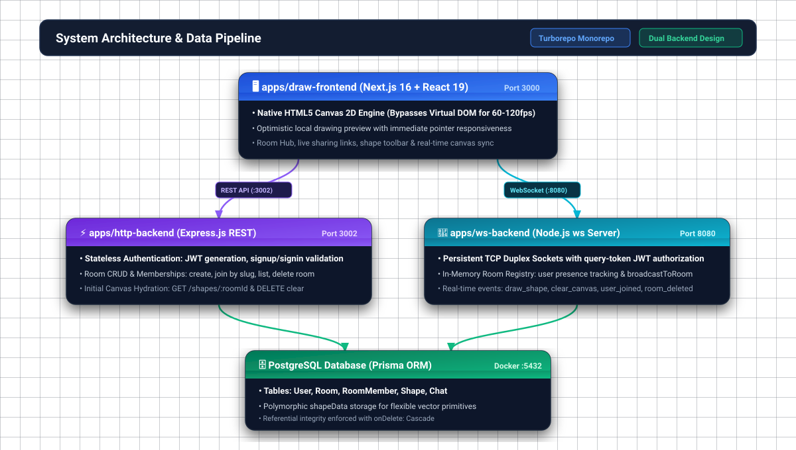
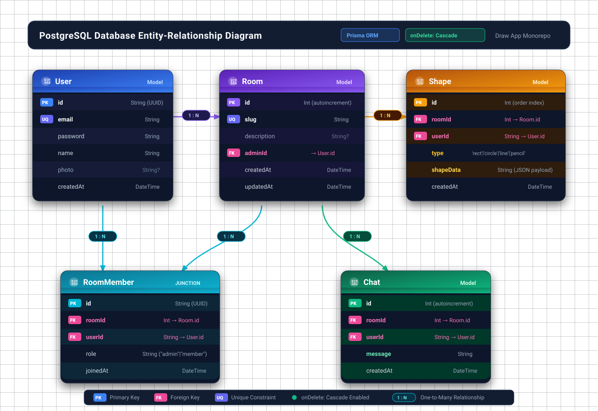
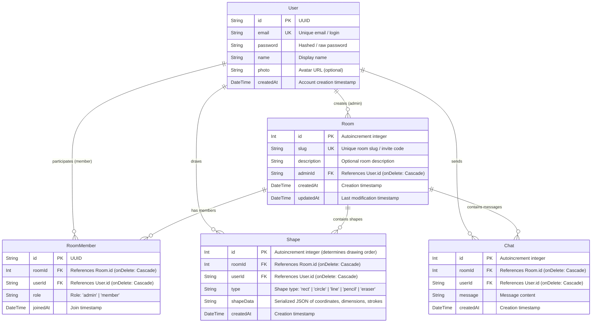

# Real-Time Collaborative Whiteboard — Comprehensive Project & Interview Guide

This guide is designed as a single source of truth for understanding the architecture, design choices, tradeoffs, and technical implementation of the **Draw App**. It includes a complete system overview, in-depth technical breakdowns, production scaling strategies, and **20 interview questions with senior-level answers**.

---

## Table of Contents

1. [Project Executive Summary & Pitch](#1-project-executive-summary--pitch)
2. [End-to-End System Architecture](#2-end-to-end-system-architecture)
3. [Monorepo & Workspace Structure](#3-monorepo--workspace-structure)
4. [Database & Data Modeling](#4-database--data-modeling)
5. [Core Data Flows & Communication Protocols](#5-core-data-flows--communication-protocols)
6. [Frontend & HTML5 Canvas Engine Deep-Dive](#6-frontend--html5-canvas-engine-deep-dive)
7. [Architectural Decisions & Tradeoffs](#7-architectural-decisions--tradeoffs)
8. [Production Scaling Strategies](#8-production-scaling-strategies)
9. [20 Targeted Interview Questions & In-Depth Answers](#9-20-targeted-interview-questions--in-depth-answers)
   - [Category 1: System Design & Architecture (Q1–Q5)](#category-1-system-design--architecture)
   - [Category 2: Real-Time Communication & WebSockets (Q6–Q10)](#category-2-real-time-communication--websockets)
   - [Category 3: Frontend & Canvas Graphics Engineering (Q11–Q15)](#category-3-frontend--canvas-graphics-engineering)
   - [Category 4: Database, Security & Production Scaling (Q16–Q20)](#category-4-database-security--production-scaling)

---

## 1. Project Executive Summary & Pitch

### The 30-Second Elevator Pitch

> _"I built a real-time collaborative whiteboard web application inspired by tools like Excalidraw and Miro. It allows multiple distributed users to join shared rooms and draw simultaneously with ultra-low latency. The system is architected as a TypeScript monorepo using Turborepo and PNPM, featuring a Next.js frontend with a custom HTML5 canvas rendering engine, an Express.js REST API for authentication and room management, and a dedicated WebSocket server for high-throughput, low-latency shape broadcasting and persistence into PostgreSQL via Prisma ORM."_

### The 2-Minute Deep Dive

> _"When designing this collaborative drawing platform, I focused on three engineering priorities: **sub-50ms visual responsiveness**, **strict separation of concerns between stateful and stateless traffic**, and **end-to-end type safety**._
>
> _On the frontend, rather than relying on heavy third-party canvas wrappers, I developed a lightweight, pure TypeScript canvas engine interacting directly with the HTML5 2D Context. It completely bypasses the React Virtual DOM during high-frequency pointer movements (60–120fps) to eliminate rendering bottlenecks._
>
> _On the backend, I separated the system into two distinct services: an HTTP REST API handling stateless operations (JWT authentication, room creation, membership lookups, initial shape hydration), and a dedicated WebSocket server handling long-lived, bi-directional TCP connections. When a client finishes a stroke, the vector payload is broadcast to all participants in that room and persisted asynchronously to PostgreSQL._
>
> _By using a Turborepo monorepo, our shared schemas—validated at runtime with Zod—ensure that the frontend, HTTP server, and WebSocket server all consume identical shape and message contracts without duplicate type definitions."_

---

## 2. End-to-End System Architecture



### Component Responsibilities

| Component                     | Technology                                     | Primary Responsibility                                                                                                                                     |
| ----------------------------- | ---------------------------------------------- | ---------------------------------------------------------------------------------------------------------------------------------------------------------- |
| **`apps/draw-frontend`**      | Next.js 16 (Turbopack), React 19, Tailwind CSS | Client UI, authentication flows, Room Hub, and the immediate-mode Canvas engine.                                                                           |
| **`apps/http-backend`**       | Node.js, Express.js, TypeScript                | Stateless REST endpoints: user authentication (JWT), room metadata CRUD, initial canvas hydration (`GET /shapes/:roomId`), room deletion, and leave flows. |
| **`apps/ws-backend`**         | Node.js, `ws` library, TypeScript              | Stateful bi-directional streaming: connection authorization, in-memory room tracking, broadcasting live strokes to peers, and persisting shape records.    |
| **`packages/db`**             | Prisma ORM, PostgreSQL (Docker)                | Single source of truth for the database schema, migrations, and generated type-safe database client.                                                       |
| **`packages/common`**         | Zod, TypeScript                                | Shared data schemas and inferred types (e.g., `CreateUserSchema`, `ShapeSchema`, `PointSchema`) used across frontend and backends.                         |
| **`packages/common-backend`** | TypeScript                                     | Shared backend utilities and environment configs (e.g., `JWT_SECRET`).                                                                                     |

---

## 3. Monorepo & Workspace Structure

The project uses **PNPM Workspaces** coordinated by **Turborepo** (`turbo.json`).

### Directory Layout

```
draw-app/
├── apps/
│   ├── draw-frontend/       # Next.js client application
│   │   ├── app/             # App Router pages (/canvas/[roomId], /rooms, /signin, etc.)
│   │   ├── components/      # UI components (CanvasComponent, RoomHub, RoomCard)
│   │   └── draw/            # Pure TypeScript Canvas engine (events, shape renderers)
│   ├── http-backend/        # Express REST API (auth, rooms, shapes)
│   └── ws-backend/          # WebSocket event server (handlers, registry)
├── packages/
│   ├── common/              # Shared Zod validation schemas and TypeScript types
│   ├── common-backend/      # Shared backend config (JWT_SECRET)
│   ├── db/                  # Prisma schema, migrations, and generated client
│   ├── ui/                  # Shared React UI components
│   ├── eslint-config/       # Shared ESLint configs
│   └── typescript-config/   # Shared tsconfig bases
├── docker-compose.yml       # Local PostgreSQL container service
├── turbo.json               # Pipeline definition (build, dev, lint, check-types)
└── pnpm-workspace.yaml      # Monorepo package boundaries
```

### Why Turborepo?

1. **Shared Contract Consistency**: If a shape property changes in `packages/common`, TypeScript immediately flags errors across both `draw-frontend` and `ws-backend`.
2. **Atomic Commits & Versioning**: Frontend and backend features (e.g., adding a new "eraser" or "delete room" feature) are shipped in a single atomic commit without API version skew.
3. **Optimized Build Pipelines**: Turborepo caches task outputs (like TypeScript builds and linting) based on file hashes, running tasks in parallel across CPU cores.

---

## 4. Database & Data Modeling

The database is built on **PostgreSQL** using **Prisma ORM** (`packages/db/prisma/schema.prisma`).

### Visual Entity-Relationship (ER) Diagram



---

### Mermaid ER Diagram



---

### Table Relationships & Cardinality Map

| From Entity | Relation    | To Entity      | Foreign Key                    | Cardinality | Cascade Action      | Description                                                                                        |
| ----------- | ----------- | -------------- | ------------------------------ | ----------- | ------------------- | -------------------------------------------------------------------------------------------------- |
| **User**    | AdminRooms  | **Room**       | `Room.adminId -> User.id`      | **1 : N**   | `onDelete: Cascade` | A user can create and administer multiple rooms. Deleting the user deletes their created rooms.    |
| **User**    | Memberships | **RoomMember** | `RoomMember.userId -> User.id` | **1 : N**   | `onDelete: Cascade` | Junction entity allowing a user to join many rooms.                                                |
| **Room**    | Members     | **RoomMember** | `RoomMember.roomId -> Room.id` | **1 : N**   | `onDelete: Cascade` | Represents all participants who have joined the room. Compound unique on `(roomId, userId)`.       |
| **Room**    | Shapes      | **Shape**      | `Shape.roomId -> Room.id`      | **1 : N**   | `onDelete: Cascade` | All vector drawings belonging to the whiteboard canvas. Chronologically ordered by `Shape.id ASC`. |
| **User**    | Shapes      | **Shape**      | `Shape.userId -> User.id`      | **1 : N**   | `onDelete: Cascade` | Identifies which participant drew each shape.                                                      |
| **Room**    | Chats       | **Chat**       | `Chat.roomId -> Room.id`       | **1 : N**   | `onDelete: Cascade` | Chat messages scoped to the room.                                                                  |

### Key Schema Considerations

1. **Compound Index on RoomMember**:

   ```prisma
   @@unique([roomId, userId])
   @@index([roomId])
   @@index([userId])
   ```

   Enforces idempotency when a user rejoins a room (`upsert`) and enables $O(1)$ lookups for room membership.

2. **Polymorphic Storage for Shapes (`shapeData: String`)**:
   - Different shapes have different attributes: a rectangle has `{ startX, startY, width, height }`; a pencil has `{ stroke: Point[] }`; a circle has `{ radius, startX, startY }`.
   - Storing shape attributes as serialized JSON strings avoids bloated sparse tables or complex multi-table inheritance schemas.
   - The `type` column is indexed and stored separately to allow fast filtering.

3. **Cascading Deletions (`onDelete: Cascade`)**:
   - When a `Room` is deleted by its admin, PostgreSQL automatically cascades the deletion to all associated `RoomMember`, `Shape`, and `Chat` rows, eliminating orphaned data without requiring multi-query manual cleanups.

---

## 5. Core Data Flows & Communication Protocols

### 1. Authentication Flow

- **HTTP**: The client posts credentials to `/signup` or `/signin`. On success, the server returns a signed JWT containing `{ userId }`. The client stores the JWT in `localStorage`. Subsequent HTTP calls pass `Authorization: Bearer <token>`.
- **WebSocket Upgrade**: Browsers do not support custom HTTP headers in the native `new WebSocket()` constructor. Therefore, the client supplies the JWT as a query parameter during connection initialization:
  ```
  ws://localhost:8080?token=<JWT_TOKEN>
  ```
  During the connection upgrade, `ws-backend/src/auth.ts` extracts and verifies the token against `JWT_SECRET`. If invalid or expired, the socket is immediately terminated with WebSocket close code `1008 (Policy Violation)`.

### 2. Room Joining & Canvas Hydration Flow

```
User navigates to /canvas/room-slug
        │
        ├─ 1. HTTP POST /room/join (Payload: { slug })
        │     • Verifies room existence
        │     • Upserts user into RoomMember table
        │     • Returns numeric roomId and admin status
        │
        ├─ 2. HTTP GET /shapes/:roomId
        │     • Fetches all persisted shapes in chronological order (id ASC)
        │     • Client canvas draws existing shapes immediately
        │
        ├─ 3. WS Connect: ws://localhost:8080?token=...
        │     • On open, sends: { type: "join_room", roomId }
        │     • Server registers socket in room Set<number>
        │     • Server broadcasts { type: "user_joined" } to other participants
```

### 3. Real-Time Drawing Flow

```
Client A (Drawing User)               WS Server                     Client B (Peer)
       │                                  │                                │
[Pointer Move]                            │                                │
Render live preview locally               │                                │
       │                                  │                                │
[Pointer Up]                              │                                │
Push shape to local shapes[]              │                                │
Send WS: { type: "draw_shape",            │                                │
           roomId, shape }                │                                │
       ──────────────────────────────────>│                                │
                                          ├─ 1. Asynchronously insert      │
                                          │     into PostgreSQL (Shape)    │
                                          │                                │
                                          ├─ 2. broadcastToRoom(roomId)    │
                                          │     (excluding Client A)       │
                                          └───────────────────────────────>│
                                                                           │
                                                                 Append to shapes[]
                                                                 Trigger clearAndRedraw()
```

---

## 6. Frontend & HTML5 Canvas Engine Deep-Dive

The drawing engine (`apps/draw-frontend/draw/`) is intentionally decoupled from React's rendering lifecycle.

### Immediate Mode vs. Retained Mode

- HTML5 Canvas uses an **immediate mode** graphics model: once pixels are rasterized onto the bitmap, the canvas retains no internal memory of "objects" (it only holds pixels).
- To support live previews, real-time collaboration, window resizing, and clearing, the frontend maintains a client-side retained shape store:
  ```ts
  const shapes: Shape[] = [];
  ```
- Any visual change executes a clean redraw:
  ```ts
  function clearAndRedraw(canvas, ctx, shapes) {
    ctx.clearRect(0, 0, canvas.width, canvas.height);
    fillCanvas(ctx, canvas); // Fill with black background
    redrawShapes(ctx, shapes); // Re-render all confirmed shapes
  }
  ```

### Why React `useRef` Instead of React State for Drawing?

During a mouse drag, `pointermove` events fire up to **120 times per second**. If coordinates or current tool state were stored in React `useState`:

1. Every micro-movement would trigger a React component re-render and Virtual DOM reconciliation.
2. High-frequency garbage collection would cause frame drops and noticeable lag.
3. React state updates are asynchronous and batched, meaning canvas event listeners would read stale coordinate closures.

**Solution**:

- We use mutable React refs: `canvasRef`, `isMouseDown = useRef(false)`, and `shapeTypeRef = useRef(shapeType)`.
- The canvas event loop runs directly in the browser's native event dispatcher, achieving smooth 60–120 FPS rendering.

### Shape Mathematics & Implementations

1. **Rectangle (`rect.ts`)**:
   - Computes width and height from displacement: `width = currentX - startX`, `height = currentY - startY`.
   - Drawn via `ctx.strokeRect(startX, startY, width, height)`. Negative width/height naturally handles dragging up/left.

2. **Circle / Ellipse (`circle.ts`)**:
   - Uses bounding box dimensions:
     ```ts
     const radiusX = Math.abs(shape.x - shape.startX) * 0.5;
     const radiusY = Math.abs(shape.y - shape.startY) * 0.5;
     const centerX = shape.startX + (shape.x - shape.startX) * 0.5;
     const centerY = shape.startY + (shape.y - shape.startY) * 0.5;
     ctx.ellipse(centerX, centerY, radiusX, radiusY, 0, 0, Math.PI * 2);
     ```

3. **Pencil / Freehand (`pencil.ts`)**:
   - Accumulates an array of sampled points `{ x, y }` on each `pointermove`.
   - Iterates through the point stream connecting lines: `ctx.moveTo(p0.x, p0.y)` followed by `ctx.lineTo(pi.x, pi.y)`.

4. **Eraser (`eraser.ts`)**:
   - Uses the Canvas composite blending mode:
     ```ts
     ctx.globalCompositeOperation = "destination-out";
     ```
   - Instead of drawing white or black pixels over the canvas, `destination-out` clears underlying pixels to transparent, preserving layer composition. It resets to `source-over` immediately after stroke execution.

5. **Style Isolation**:
   - Every shape renderer is wrapped in `ctx.save()` and `ctx.restore()` within `drawShapes.ts`. This guarantees that changes to `lineWidth`, `strokeStyle`, or `globalCompositeOperation` never leak into subsequent shapes.

---

## 7. Architectural Decisions & Tradeoffs

| Decision                     | Chosen Approach                                                   | Alternative Considered                                          | Why This Choice Was Made & Tradeoff                                                                                                                                                                                                                                                                                                    |
| ---------------------------- | ----------------------------------------------------------------- | --------------------------------------------------------------- | -------------------------------------------------------------------------------------------------------------------------------------------------------------------------------------------------------------------------------------------------------------------------------------------------------------------------------------- |
| **Server Architecture**      | Split HTTP API (`http-backend`) + WebSocket Server (`ws-backend`) | Single Monolithic Express Server with WebSockets attached       | **Why:** Stateful WebSockets and stateless HTTP endpoints have fundamentally different resource profiles. WebSockets consume persistent TCP socket descriptors and memory; HTTP requests require high CPU concurrency and scale to zero easily.<br>**Tradeoff:** Operational overhead of running and deploying two separate processes. |
| **Shape Storage Schema**     | Polymorphic stringified JSON (`shapeData`)                        | Strict Normalized SQL columns per shape type                    | **Why:** Shapes vary drastically in schema (e.g., Freehand has 100+ points; Rectangles have 4 numbers). Adding new tools (e.g., arrows, text) requires zero database migrations.<br>**Tradeoff:** Loss of native SQL column indexing inside the shape payload (mitigated in production using PostgreSQL JSONB).                        |
| **Collaboration Sync Model** | Last-Write-Wins (LWW) Append-Only Event Stream                    | CRDTs (e.g., Yjs, Automerge) or Operational Transformation (OT) | **Why:** In a digital whiteboard, shapes are discrete vector entities that are primarily _appended_. Concurrent draws rarely conflict at the pixel level.<br>**Tradeoff:** True simultaneous edits to the _exact same shape_ (e.g., moving a rectangle) would require conflict resolution like vector clocks or CRDTs.                 |
| **State Synchronization**    | In-Memory Registry (`ConnectedUser[]` array)                      | Redis Pub/Sub                                                   | **Why:** Eliminates infrastructure complexity for local dev and small-to-medium single-node deployments.<br>**Tradeoff:** Server cannot scale horizontally across multiple instances without a pub/sub backbone like Redis.                                                                                                            |
| **Drawing Rendering Flow**   | Optimistic Local Preview + Async Remote Broadcast                 | Server-Confirmed Drawing (render only after ACK)                | **Why:** Drawing requires instantaneous local feedback (0ms perceived latency). Waiting for server round-trip feels sluggish and unusable.<br>**Tradeoff:** If network connection drops mid-draw, optimistic stroke must be cleaned up on sync failure.                                                                                |
| **Client Rendering Engine**  | Pure TypeScript native HTML5 Canvas                               | Third-party libraries (Fabric.js, Konva, Pixi.js)               | **Why:** Zero bloat, total control over rendering loop, no dependency lock-in, deep understanding of 2D geometry and composite operations.<br>**Tradeoff:** Must manually build object selection, transforms, and bounding-box hit detection from scratch.                                                                             |

---

## 8. Production Scaling Strategies

When asked in an interview: _"How would you take this project from an MVP to handling 100,000 concurrent users?"_, discuss these four pillars:

### 1. Horizontal Scaling with Redis Pub/Sub

- **Problem**: In the current implementation, `users: ConnectedUser[]` lives in the Node.js process memory. If User A connects to WS Server 1 and User B connects to WS Server 2, they cannot communicate.
- **Solution**:
  - Deploy multiple stateless WS backend instances behind an L4/L7 Load Balancer (e.g., AWS ALB or NGINX with sticky sessions).
  - Use **Redis Pub/Sub** or **Redis Streams**. When Server 1 receives `draw_shape`, it publishes to Redis channel `room:{roomId}`. All WS instances subscribed to that channel receive the frame and forward it to their locally connected room participants.

### 2. Database Write-Behind Buffer (Throttling)

- **Problem**: 10,000 active users drawing continuously can produce 5,000–20,000 shapes/sec, exhausting database connection pools and overwhelming PostgreSQL write throughput.
- **Solution**:
  - Decouple the real-time broadcast from the persistence layer.
  - When `draw_shape` arrives at the WS server, broadcast it to peers immediately (in-memory, <5ms).
  - Push the shape payload into a high-throughput queue (**Apache Kafka**, **RabbitMQ**, or **Redis BullMQ**).
  - Worker services consume from the queue and perform batch inserts (`prisma.shape.createMany()`) every 500ms, reducing database write IOPS by over 90%.

### 3. Canvas Virtualization & Spatial Indexing (R-Tree)

- **Problem**: Re-rendering 50,000 vector shapes on every mouse move in an infinite canvas degrades frame rates below 60fps.
- **Solution**:
  - Implement an **R-Tree (Bounding Volume Hierarchy)** on the client.
  - Compute the current viewport's bounding coordinates `(viewportLeft, viewportTop, viewportRight, viewportBottom)`.
  - Only query and rasterize shapes that intersect the visible viewport (viewport culling).
  - Use `OffscreenCanvas` in a Web Worker to perform drawing off the main browser thread.

### 4. Connection Resilience & Reconnection Protocol

- Implement exponential backoff with jitter for WebSocket reconnection.
- When reconnecting, send `{ type: "sync", lastShapeId: X }`. The server returns only missing shapes created after `lastShapeId`, avoiding a full canvas re-fetch.

---

## 9. 20 Targeted Interview Questions & In-Depth Answers

---

### Category 1: System Design & Architecture

#### Q1: Can you walk me through the high-level architecture of your collaborative drawing app?

**Interviewer Goal**: Evaluate whether you understand how all the moving parts fit together and why you chose this design.

**Candidate Answer**:

> \*"The application is structured as a decoupled monorepo managed with Turborepo and PNPM. It consists of three tiers:
>
> 1. **Client Tier**: A Next.js 16 web application utilizing React 19, Tailwind CSS, and a custom immediate-mode HTML5 Canvas engine. It manages local shape previews, optimizes render cycles outside the React state loop, and establishes both HTTP and WebSocket connections.
> 2. **Application Server Tier**: We split backend responsibilities into two distinct microservices:
>    - `http-backend`: An Express REST API that handles stateless requests including user registration, sign-in, JWT generation, room CRUD, and initial canvas shape hydration.
>    - `ws-backend`: A dedicated Node.js WebSocket service responsible for long-lived duplex connections, room-based presence, real-time stroke broadcasting, and persistence.
> 3. **Data Tier**: A PostgreSQL database managed through Prisma ORM, containerized with Docker, maintaining relational models for Users, Rooms, Memberships, and polymorphic Shape data.
>
> Shared validation logic and TypeScript contracts live in `@repo/common`, ensuring end-to-end type safety across the entire stack."\*

---

#### Q2: Why did you separate the HTTP backend and the WebSocket backend instead of running them on a single server?

**Interviewer Goal**: Test your knowledge of networking, resource utilization, and microservice decoupling.

**Candidate Answer**:

> \*"We separated them because stateless REST traffic and stateful WebSocket traffic have fundamentally conflicting scaling and operational characteristics:
>
> - **Resource Utilization**: HTTP requests are short-lived, bursty, and CPU-intensive (parsing JSON, hashing passwords, querying DB). They can easily auto-scale horizontally up and down based on incoming request rates. Conversely, WebSockets are long-lived, persistent TCP connections that hold open file descriptors and consume memory over time.
> - **Deployment & Zero-Downtime Deployments**: Updating a REST route shouldn't terminate thousands of active whiteboard sessions. By isolating `ws-backend`, we can redeploy the REST API without dropping live WebSocket connections.
> - **Failure Isolation**: A spike in expensive REST queries (e.g., heavy room analytics or search) won't exhaust the event loop of the WebSocket server, ensuring that live drawing latency remains under 50ms."\*

---

#### Q3: Why did you choose a Turborepo monorepo instead of separate Git repositories?

**Interviewer Goal**: Test your understanding of modern frontend/backend tooling and team developer experience (DX).

**Candidate Answer**:

> \*"In a multi-service application with a frontend and two backends, having independent repositories leads to contract drift—where the frontend expects a shape schema that the WebSocket server hasn't implemented yet.
>
> With Turborepo and PNPM:
>
> 1. **Shared Single Source of Truth**: We maintain `@repo/common` which exports Zod schemas (like `ShapeSchema` and `CreateRoomSchema`). Both the frontend and backends import these exact types. If a shape attribute is renamed, the TypeScript compiler catches all breaking changes across both services immediately at build time.
> 2. **Fast Cached Builds**: Turborepo uses hash-based task caching. If we only modify code in `apps/draw-frontend`, running `turbo run build` instantly replays cached artifacts for `http-backend` and `ws-backend`.
> 3. **Simplified Local Development**: Running `pnpm dev` at the root initiates all three services concurrently with unified logging."\*

---

#### Q4: How is data modeled in PostgreSQL, and why did you store shapes as a stringified `shapeData` column?

**Interviewer Goal**: Assess relational database design skills and handling of polymorphic data structures.

**Candidate Answer**:

> \*"Our Prisma schema models Users, Rooms, RoomMembers, Shapes, and Chats with foreign keys and cascading deletes (`onDelete: Cascade`).
>
> For the `Shape` model, shapes are inherently polymorphic:
>
> - A rectangle needs `startX, startY, width, height`.
> - A circle needs `startX, startY, x, y, radius`.
> - A freehand pencil or eraser stroke contains an arbitrary array of `Point { x, y }` coordinates.
>
> If we used traditional relational columns, we would either have a wide, sparse table full of nulls or multiple joined tables for every shape type, complicating query performance. Instead, we store common indexed metadata (`id`, `roomId`, `userId`, `type`, `createdAt`) as first-class columns, while storing specific vector geometries inside `shapeData` as a serialized string. This gives us schema flexibility to add new tools (like arrows, text, or highlighters) without requiring database migrations."\*

---

#### Q5: How do you handle authentication across both HTTP and WebSocket protocols?

**Interviewer Goal**: Understand your grasp of authentication protocols, JWTs, and WebSocket handshake constraints.

**Candidate Answer**:

> \*"We use stateless JSON Web Tokens (JWT):
>
> 1. **Authentication**: During sign-in (`POST /signin`), the server validates credentials against PostgreSQL and generates a JWT signed with a secret (`JWT_SECRET`), embedding the `userId` in the payload. The client stores this in `localStorage`.
> 2. **HTTP Authorization**: Standard Express middleware (`middleware.ts`) extracts the `Authorization: Bearer <token>` header, verifies the signature using `jsonwebtoken`, and attaches `req.userId` to the request object.
> 3. **WebSocket Upgrade Authorization**: The browser's native `WebSocket` API does not allow sending custom HTTP headers during connection establishment. To solve this, the client passes the token as a query parameter:
>    ```ts
>    new WebSocket(`${WS_BACKEND}?token=${token}`);
>    ```
>    During connection negotiation, `ws-backend/src/auth.ts` parses the URL, validates the JWT, and extracts `userId`. If validation fails, it aborts the handshake with close code `1008 (Unauthorized)`, preventing unauthenticated connections from ever occupying server memory."\*

---

### Category 2: Real-Time Communication & WebSockets

#### Q6: How does the WebSocket server track which users belong to which rooms?

**Interviewer Goal**: Understand how you maintain state in Node.js processes.

**Candidate Answer**:

> \*"The WebSocket server maintains an in-memory registry defined in `registry.ts`:
>
> ```ts
> export interface ConnectedUser {
>   ws: WebSocket;
>   userId: string;
>   rooms: Set<number>;
> }
> export const users: ConnectedUser[] = [];
> ```
>
> When a client connects, a `ConnectedUser` object is instantiated and registered. When they send a `{ type: "join_room", roomId }` message, `user.rooms.add(roomId)` associates the room ID with that socket.
>
> When broadcasting an event, `broadcastToRoom(roomId, payload, excludeWs)` iterates through `users`. It checks:
>
> 1. Does `user.rooms.has(roomId)` evaluate to true?
> 2. Is `user.ws` different from the sender's socket (avoiding duplicate echo)?
> 3. Is `user.ws.readyState === WebSocket.OPEN`?
>
> When a user disconnects, the socket's `close` event triggers `unregisterUser(user)`, preventing memory leaks."\*

---

#### Q7: What happens when two users draw simultaneously? How are conflicts handled?

**Interviewer Goal**: Assess your understanding of concurrency, race conditions, and collaboration models (CRDT vs. OT vs. Event Streaming).

**Candidate Answer**:

> \*"Our whiteboard uses an **append-only event streaming model with Last-Write-Wins (LWW)** ordering determined by the database auto-increment ID / timestamp.
>
> In whiteboard applications, unlike collaborative text editing (which requires Operational Transformation or CRDT character-level merging), vector shapes are discrete, independent objects. If Alice draws a rectangle at position `(100, 100)` and Bob draws a circle at position `(150, 150)` at the same time:
>
> 1. Both clients render their own shape instantly using optimistic local rendering.
> 2. Both shapes are dispatched to `ws-backend`.
> 3. The server assigns each shape an auto-incrementing ID in PostgreSQL as it inserts them.
> 4. Both clients receive the other peer's shape and append it to their local array, drawing it on top.
>
> The canvas renders shapes in array index order. Because shapes are additive, no data is lost or overwritten."\*

---

#### Q8: How would you scale the WebSocket backend across multiple server instances?

**Interviewer Goal**: Evaluate system design knowledge for horizontal scaling and multi-node pub/sub.

**Candidate Answer**:

> \*"Right now, the server maintains an in-memory array of connected sockets. If we add a second WS instance, users connected to Server 1 wouldn't receive shapes drawn by users on Server 2.
>
> To scale horizontally:
>
> 1. **Redis Pub/Sub Layer**: We introduce a Redis cluster. When Server 1 receives a `draw_shape` frame for room `42`, it publishes the payload to a Redis channel named `room:42`.
> 2. **Cross-Server Fan-out**: All WS servers subscribe to channels for rooms their active clients inhabit. Server 2 receives the Redis message and broadcasts it to its local sockets in room `42`.
> 3. **Load Balancing**: We place an L4/L7 load balancer (e.g., NGINX, HAProxy, or AWS ALB) in front of the WS fleet with WebSocket upgrade support and IP hash or cookie-based sticky sessions for connection stabilization."\*

---

#### Q9: Why did you choose WebSockets over Server-Sent Events (SSE) or Long Polling?

**Interviewer Goal**: Evaluate deep understanding of browser-to-server real-time communication protocols.

**Candidate Answer**:

> \*"We evaluated three real-time approaches:
>
> 1. **HTTP Long Polling**: Incurs heavy HTTP request/response header overhead (1–2 KB per packet), high server CPU utilization, and noticeable latency. Unsuitable for 60fps real-time drawing.
> 2. **Server-Sent Events (SSE)**: SSE is strictly **unidirectional** (server-to-client). While great for notifications or live stock tickers, drawing requires bidirectional streaming. If we used SSE, client drawing events would still have to be sent via separate HTTP POST requests, incurring TCP connection overhead and latency on every stroke.
> 3. **WebSockets (Selected)**: Provides a single, persistent, full-duplex TCP connection with minimal framing overhead (only 2 to 10 bytes per frame). This delivers the sub-30ms latency necessary for collaborative drawing to feel tactile and instantaneous."\*

---

#### Q10: How does the real-time Room Deletion feature work?

**Interviewer Goal**: Test how you handle destructive operations across distributed clients.

**Candidate Answer**:

> \*"Room deletion requires coordinated synchronization across the database and all active sessions:
>
> 1. **Authorization Check**: In `apps/http-backend/src/routes/rooms.ts`, the server verifies that the requesting user's ID matches the room's `adminId`. Non-admins receive `403 Forbidden`.
> 2. **Database Cascade**: Calling `prisma.room.delete({ where: { id: roomId } })` leverages PostgreSQL cascade constraints to automatically delete associated shapes and room memberships.
> 3. **Real-Time Notification**: The client dispatches a `delete_room` WebSocket message. The WebSocket handler executes `handleDeleteRoom`:
>    ```ts
>    broadcastToRoom(roomId, { type: "room_deleted", roomId, deletedBy });
>    for (const u of users) u.rooms.delete(roomId);
>    ```
> 4. **Client-Side Graceful Exit**: In `CanvasComponent.tsx`, the client listens for `room_deleted`. When received, an alert notifies the user, and Next.js redirects them out of the canvas back to `/rooms`."\*

---

### Category 3: Frontend & Canvas Graphics Engineering

#### Q11: Why is the Canvas engine written in pure TypeScript outside React's component state?

**Interviewer Goal**: Test understanding of React performance bottlenecks, garbage collection, and 60fps rendering.

**Candidate Answer**:

> \*"When a user draws a complex freehand stroke, the browser dispatches `pointermove` events at the display's refresh rate (60Hz to 144Hz).
>
> If we routed every coordinate through React's `useState`:
>
> 1. React would trigger component re-renders, hook evaluations, and Virtual DOM diffing up to 144 times every second.
> 2. The React scheduler batches state updates, introducing frame jitter and perceived drawing lag.
> 3. Constantly creating short-lived state objects causes frequent browser garbage collection pauses.
>
> Instead, we encapsulate the canvas engine inside `apps/draw-frontend/draw/index.ts` as a pure TypeScript module. It attaches native DOM event listeners directly to the `<canvas>` element and mutates in-memory coordinate buffers, executing at native 60–120 FPS with 0% React reconciliation overhead."\*

---

#### Q12: How does the live preview mechanism work when dragging a shape?

**Interviewer Goal**: Understand canvas clearing, double-buffering, and visual preview mechanics.

**Candidate Answer**:

> \*"When creating a shape (like a rectangle or circle), the user clicks and drags to adjust its dimensions before releasing:
>
> 1. `onPointerDown`: We record `startX = x` and `startY = y`, set `isMouseDown = true`, and initialize an empty `liveStrokes` buffer.
> 2. `onPointerMove`: As the cursor moves to `(x, y)`:
>    - We execute `clearAndRedraw(canvas, ctx, shapes)`. This completely clears the canvas, restores the background, and redraws all previously confirmed shapes.
>    - We generate an ephemeral preview shape using `getShapeData(currentTool, startX, startY, x, y)`.
>    - We immediately render this preview shape onto the canvas using `drawShape(ctx, preview)`.
>    - Notice that this preview shape is **not** pushed to the persistent `shapes` array yet.
> 3. `onPointerUp`: The final coordinates are captured. The finalized shape is pushed into the persistent `shapes` array, and a `draw_shape` payload is dispatched over the WebSocket."\*

---

#### Q13: How did you implement the Eraser tool on an HTML5 Canvas?

**Interviewer Goal**: Test knowledge of HTML5 Canvas 2D Context blend modes and composite operations.

**Candidate Answer**:

> \*"A naive implementation of an eraser simply draws lines matching the background color (e.g., drawing black strokes). However, this fails if there is a background grid, image, or gradient—it leaves ugly opaque streaks.
>
> Instead, in `eraser.ts`, we utilize the Canvas 2D `globalCompositeOperation` property:
>
> ```ts
> ctx.beginPath();
> ctx.globalCompositeOperation = "destination-out";
> ctx.lineWidth = shape.size;
> ctx.lineCap = "round";
> ctx.lineJoin = "round";
> // stroke through points...
> ctx.stroke();
> ctx.globalCompositeOperation = "source-over"; // restore default
> ```
>
> `destination-out` treats new strokes as an alpha mask, punching transparent holes through existing canvas pixels where the brush passes. Once finished, we restore the context to `source-over` so subsequent drawings render normally."\*

---

#### Q14: How do you handle canvas coordinate offsets and window resizing?

**Interviewer Goal**: Understand DOM geometry, viewport offsets, and canvas buffer resolution vs. CSS size.

**Candidate Answer**:

> \*"There are two critical considerations when mapping pointer events to canvas pixels:
>
> 1. **Viewport Offset Correction**:
>    Pointer events provide `clientX` and `clientY` relative to the browser window, not the canvas. If there is navigation padding, coordinates will be misaligned. In `getCoords(e)`, we calculate:
>    ```ts
>    const rect = canvas.getBoundingClientRect();
>    return { x: e.clientX - rect.left, y: e.clientY - rect.top };
>    ```
> 2. **Buffer Dimensions vs. CSS Display Size**:
>    In HTML5, `<canvas>` has both an internal bitmap buffer size (`width`, `height`) and a CSS layout size (`offsetWidth`, `offsetHeight`). If these diverge, drawn vectors appear blurry or stretched.
>    To handle this, we register a `resize` listener:
>    ```ts
>    function resizeCanvas() {
>      canvas.width = canvas.offsetWidth;
>      canvas.height = canvas.offsetHeight;
>      clearAndRedraw(canvas, ctx, shapes);
>    }
>    ```
>    Whenever the viewport dimensions change, the bitmap buffer matches the screen pixels 1:1, and all existing shapes are re-rendered sharply."\*

---

#### Q15: In `CanvasComponent.tsx`, why did you pass `shapeTypeRef` as a React Ref into `initCanvas` instead of adding `shapeType` to the `useEffect` dependency array?

**Interviewer Goal**: Evaluate mastery of React hook lifecycles, closures, and avoiding unintended effect re-runs.

**Candidate Answer**:

> \*"This was an important bug fix and optimization in the codebase:
>
> If `shapeType` were in the `useEffect` dependency array:
> Every time the user clicked a tool button (switching from Pencil to Rectangle), the entire `useEffect` would unmount, tearing down event listeners, re-allocating memory, and re-initializing the canvas. If the user switched tools mid-gesture, `startX` and `startY` would reset to `(0, 0)`, drawing a stray line to the top-left corner.
>
> Instead, we store the selected tool in a ref:
>
> ```ts
> const shapeTypeRef = useRef(shapeType);
> shapeTypeRef.current = shapeType;
> ```
>
> We pass `shapeTypeRef` into `initCanvas` once. Inside the event handlers, reading `shapeTypeRef.current` always retrieves the latest tool choice via mutable object reference without ever tearing down or re-initializing the canvas."\*

---

### Category 4: Database, Security & Production Scaling

#### Q16: How do you prevent unauthorized users from drawing in or deleting a room?

**Interviewer Goal**: Evaluate security awareness across REST endpoints and WebSocket protocols.

**Candidate Answer**:

> \*"We enforce authorization at multiple boundaries:
>
> 1. **Authentication Gate**: Both the REST API and WebSocket gateway require a valid JWT signed by our backend. Unauthenticated requests are rejected immediately.
> 2. **Role-Based Deletion**: For destructive operations like `DELETE /room/:id`, the route fetches the room and explicitly checks:
>    ```ts
>    if (room.adminId !== userId) {
>      return res.status(403).json({
>        error: "Unauthorized: only the room admin can delete this room",
>      });
>    }
>    ```
> 3. **Room Membership Scoping**: In the WebSocket server, users can only broadcast to a room if they have explicitly joined that room through the `join_room` message (which registers their socket in `user.rooms.has(roomId)`). Shapes cannot be broadcast across arbitrary room boundaries."\*

---

#### Q17: What happens to the database when 50 people draw rapidly at the same time? How would you optimize write load?

**Interviewer Goal**: Test understanding of database bottlenecks, connection pooling, and write-behind patterns.

**Candidate Answer**:

> \*"In our current implementation, every completed stroke (`pointerup`) triggers an asynchronous `prisma.shape.create()` query.
>
> If 50 users draw 2 strokes per second, that generates 100 inserts/sec, which PostgreSQL handles easily. However, with 1,000 concurrent users producing 2,000 writes/sec:
>
> 1. Connection pools would exhaust.
> 2. High write disk I/O would degrade query response times.
>
> **Production Optimization Strategy**:
>
> - Implement a **Write-Behind Buffer (Batching)**.
> - When `draw_shape` arrives at the WebSocket server, broadcast it to peers immediately (in-memory latency <5ms).
> - Push the persistence task into an in-memory queue or Redis stream.
> - Run a background worker that flushes shapes in bulk using `prisma.shape.createMany()` every 500ms. This consolidates 1,000 individual SQL inserts into a single bulk insert transaction."\*

---

#### Q18: What is the database cascading behavior when a user or room is deleted?

**Interviewer Goal**: Test understanding of foreign key constraints and referential integrity.

**Candidate Answer**:

> \*"In our `schema.prisma` file, all child models specify `onDelete: Cascade` on their foreign key relations:
>
> - If a `User` is deleted:
>   - All `Room` records where that user was `admin` are deleted.
>   - All `RoomMember` records for that user are deleted.
>   - All `Shape` and `Chat` records created by that user are deleted.
> - If a `Room` is deleted:
>   - All `RoomMember` associations are removed.
>   - All historical `Shape` vector data belonging to that room is purged.
>   - All `Chat` messages belonging to that room are purged.
>
> This guarantees referential integrity at the database engine level and prevents orphaned foreign keys without needing multiple manual cleanup queries in application code."\*

---

#### Q19: How would you implement Undo and Redo in this collaborative environment?

**Interviewer Goal**: Evaluate problem-solving skills for complex real-time distributed state manipulation.

**Candidate Answer**:

> *"Undo in a multi-user collaborative environment is notoriously tricky because you must differentiate between **Local Undo** (undoing only *my\* last stroke) and **Global Undo** (undoing the room's last stroke):
>
> 1. **Soft Deletions / Tombstones**:
>    Instead of permanently deleting a row from the database, we add an `isDeleted: Boolean @default(false)` field to the `Shape` model.
> 2. **Undo Action Protocol**:
>    When User A clicks 'Undo', the client emits `{ type: "undo_shape", roomId }`.
>    The server finds the most recent shape in `roomId` where `userId === requestingUser.id && !isDeleted`.
> 3. **Mark and Broadcast**:
>    The server sets `isDeleted = true` on that shape and broadcasts `{ type: "shape_undone", shapeId }` to all clients in the room.
> 4. **Client Canvas Update**:
>    Clients filter out `shapeId` from their in-memory `shapes` array and trigger `clearAndRedraw()`.
> 5. **Redo**:
>    Simply marks the most recently undone shape back to `isDeleted = false` and broadcasts a redraw."\*

---

#### Q20: If you had two more weeks to work on this application, what would you prioritize and why?

**Interviewer Goal**: Gauge product sense, self-awareness of technical debt, and architectural maturity.

**Candidate Answer**:

> \*"I would prioritize three enhancements:
>
> 1. **Redis Pub/Sub & Write-Behind Worker**: Transitioning the single-instance WebSocket registry to Redis-backed pub/sub with batch database writes, making the backend horizontally scalable across multiple container instances.
> 2. **Canvas Selection & Transformation Engine**: Adding a 'Select' tool allowing users to click existing shapes to move, resize, or delete them. This would require implementing hit-testing algorithms (e.g., ray-casting or point-to-line distance formulas) and tracking shape bounding boxes.
> 3. **Infinite Canvas with Pan & Zoom**: Upgrading the canvas from a fixed viewport to an infinite canvas using 2D transformation matrices (`ctx.translate`, `ctx.scale`), paired with an R-Tree spatial index to only render shapes visible within the active camera viewport."\*

---

## 10. Quick Reference Cheat Sheet

```
+------------------------+--------------------------------------------------------------+
| Metric / Component     | Value / Details                                              |
+------------------------+--------------------------------------------------------------+
| Frontend Framework     | Next.js 16 (App Router, Turbopack, React 19)                 |
| Styling                | Tailwind CSS, Lucide Icons                                   |
| HTTP Backend           | Express.js, TypeScript, Port 3002                            |
| WebSocket Backend      | Node.js ws, TypeScript, Port 8080                            |
| Database & ORM         | PostgreSQL 16 (Alpine Docker), Prisma ORM                   |
| Monorepo Tooling       | Turborepo 2.x, PNPM Workspaces (pnpm 9.0)                    |
| Authentication         | Stateless JWT (Bearer header for REST, query param for WS)  |
| Shared Types           | Zod Schemas (@repo/common)                                   |
| Canvas Render Model    | Immediate Mode 2D Context, outside React state loop (60fps)   |
| Real-time Dispatch     | In-memory registry with broadcastToRoom (LWW event stream)   |
+------------------------+--------------------------------------------------------------+
```
